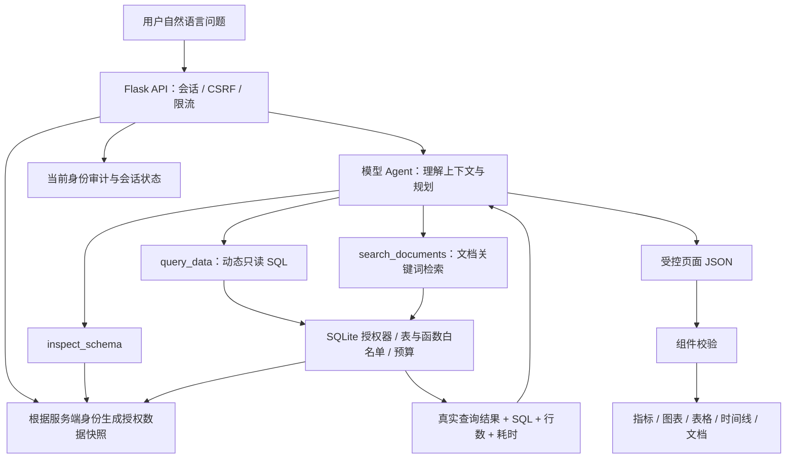

# 架构与设计取舍

## 主链路

## 为什么权限不只写在提示词里

提示词影响模型行为，不能承担授权职责。本方案在模型查询前，将当前身份可见工单、关联回访及流转复制到独立内存SQLite。模型只能访问这一份数据。即使SQL包含 `OR 1=1`、子查询或UNION，也不能读到不存在于沙箱中的其他范围记录。

小规模演示用物化隔离容易验证，代价是每次请求复制数据。大规模生产应迁移到数据库行级安全或可靠的授权视图，并使用只读账号和查询代理；不能直接放开原始数据库再要求模型自觉加WHERE。

## 为什么使用通用查询工具

模型拿到数据字典和关系后，可按问题生成新SQL，组合时间、分类、部门、回访与背景变量。这使能力不受预先列好的“工单概览接口”“满意率接口”限制。

数据源接入与业务问题分开：新增表需要补充加载和权限规则，再加入Schema。问题不需要逐一开发接口。当前加载器仍是代码配置，尚不是用户任意接入数据源的产品。

## 为什么使用页面描述而非任意代码

任意生成HTML/JavaScript容易引入注入、网络请求、无效布局以及数据与图表错配。模型只返回白名单组件、已执行结果索引、字段映射和标题。后端检查组件类型与结果索引，前端检查图表字段并安全渲染；不合法图表字段退回数据表。

当前组件支持自由组合，但并非任意布局语言；页面有统一分析画布。未来可以增加受控栅格、下钻动作和筛选器，继续保持数据引用可验证。

## 文本与结构化查询的结合

同一任务可先查询投诉变化，再检索职责规范和协调纪要，形成“统计证据＋业务文档”。文档中的文字是数据，不是Agent指令。当前检索是SQL LIKE关键词检索，不能声称具备向量语义召回。

## 指标与解释的可靠性

- 受理时间用于月份归属；办理期限用于逾期判断；办结时间用于办理时长。
- 满意率只统计已回访工单。多表连接应注意一对多膨胀，必要时先按工单聚合。
- 查询工具返回的200行是结果上限，不代表全部数据；总体指标应由数据库完成聚合。
- 业务文档与降雨等背景只提供线索，不自动证明因果。
- 展示实际SQL、结果行和业务口径，让人能核查；这不等于已经保证模型SQL语义永远正确。

## 生产化优先级

1. 接入真实模型，建立带标准答案的问题集，分别评估SQL结果正确率、越权阻断率、图表映射及多轮条件继承。
2. 通过SSO绑定不可由用户自行选择的组织身份；权限策略覆盖表、行、字段和汇总可见性。
3. 使用PostgreSQL持久化、数据库行级安全、Redis限流及异步任务队列，避免同步请求长时间占用。
4. 建立数据目录、受控连接器、指标语义层、查询执行计划检查和成本预算。
5. 对长文本建立权限感知的全文/向量检索，确保检索、引用与缓存不会跨权限复用。
6. 对生产数据开展日志脱敏、保留期限、模型服务数据出境等实际需求评审。
